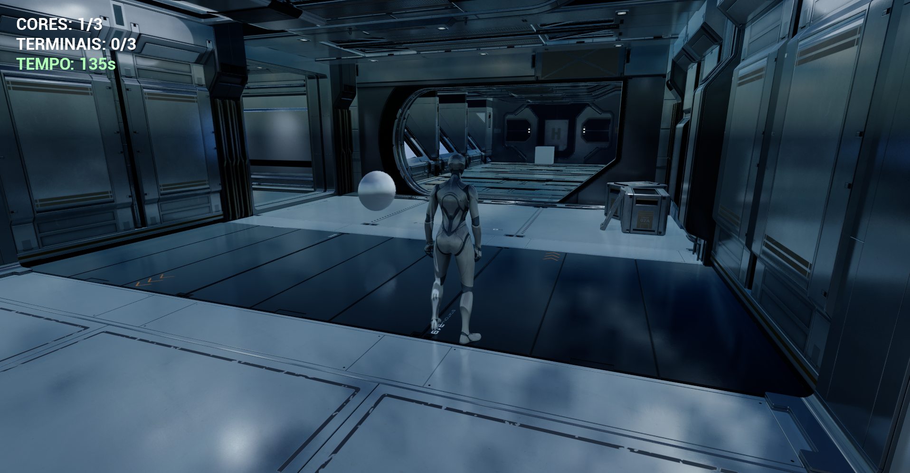
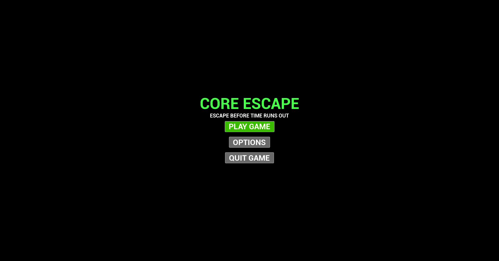
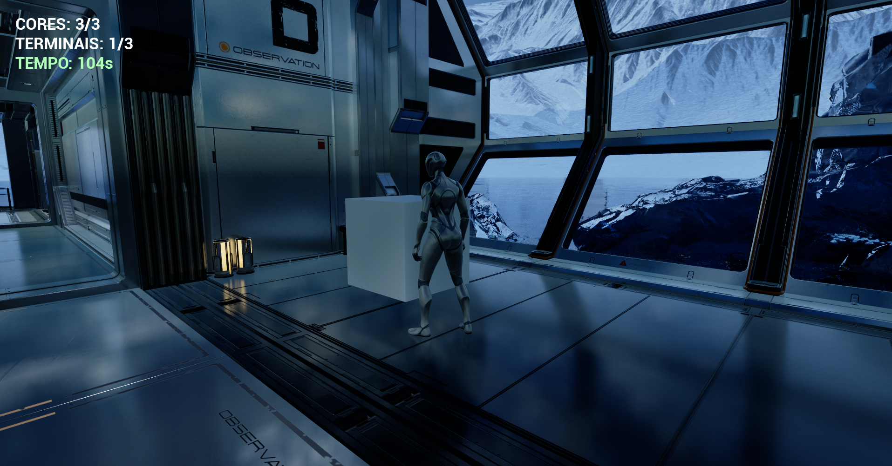
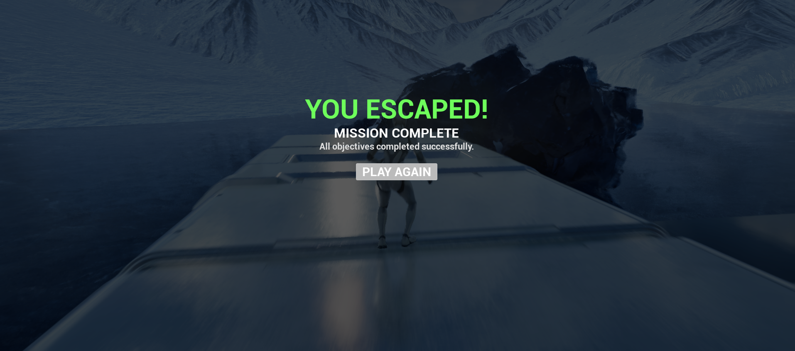

# Core Escape

**A third-person sci-fi escape gameplay prototype developed in Unreal Engine 5 using Blueprints.**



[**## Gameplay demonstration

https://github.com/user-attachments/assets/e6fc9114-4400-43de-9bd8-286dbd5dd413

 (1 min 26 sec, MP4)**](CoreEscape_Gameplay_Demo_WebPreview.mp4) · [Developer profile](https://github.com/lukyi124)

## Overview

**Core Escape** is a timed objective-based game set inside a futuristic research facility surrounded by an arctic landscape. The player must explore the installation, collect energy cores, activate control terminals, and escape through an exit door before the countdown reaches zero.

This project focuses on **Blueprint gameplay programming, reusable interaction logic, game-state management, UI, data-driven configuration, and integrating gameplay into a modular environment**. The underlying sci-fi environment uses third-party asset packs; the gameplay systems and adaptation for this prototype were developed as part of the project.

### Mission objectives

| Objective | Requirement |
| --- | --- |
| Collect energy cores | **3 / 3** |
| Activate terminals | **3 / 3** |
| Escape timer | **150 seconds** |
| Win condition | Complete both objectives, then reach the exit |
| Lose condition | Run out of time before escaping |

The HUD displays the remaining time and the progress of both objectives. The exit door becomes available once the required objectives are complete, and the game shows separate victory and defeat screens with replay functionality.

## Controls

| Input | Action |
| --- | --- |
| **W / A / S / D** | Move the character |
| **Mouse** | Look / control the camera |
| **Space** | Jump |
| **E** | **Interact with and activate a nearby terminal** |

> **Important — activating terminals:** Walk up to a terminal until you are within its interaction area, then **press `E`**. This input is handled by the Unreal Engine **Enhanced Input** action **`IA_Interact`**. Simply approaching a terminal does **not** activate it; the player must press **E**. The on-screen *TERMINALS* counter updates when activation succeeds.
>
> **Energy cores** are collected by touching / overlapping them; they do not require the E key.

## Implemented features

### Gameplay and Blueprints

- **Third-person character** with movement and jump controls.
- **Energy core pickup system** driven by collision overlaps, with a rotating visual presentation for the collectibles.
- **Terminal interaction system** using proximity detection, the `E` key, `IA_Interact`, and a one-time activation path.
- **Blueprint Event Dispatchers** for communicating core collection and terminal activation events (`OnCoreCollected` and `OnTerminalActivated`).
- **Centralized match flow** that tracks objectives, runs the countdown, and evaluates win/lose conditions.
- **Exit door logic** that responds to objective completion and supports the final escape sequence.
- **Restart flow** that correctly reloads the ArtPass gameplay map after winning or losing.

### Interface, configuration, and persistence

- **Main menu** with *Play Game*, *Options*, and *Quit Game* actions.
- **Real-time HUD** for cores, terminals, and remaining time.
- **Victory and defeat screens**, each with a replay flow.
- **Data-driven rules** through a Blueprint Structure and Data Table; the current configuration requires 3 cores, 3 terminals, and 150 seconds.
- **Persistent master-volume setting** using a SaveGame object and GameInstance logic; the selected volume is restored when the game is reopened.

### Environment and rendering

- Gameplay integrated into an existing **modular sci-fi installation** with arctic exterior scenery.
- **Material and Material Instance experimentation** for metallic walls and cyan emissive accents.
- **Lumen global illumination and reflections**, **Virtual Shadow Maps**, and controlled post-processing.
- **Rect Lights, Point Lights, fog, exposure, color grading, and bloom** for a darker, cinematic sci-fi atmosphere.

## Technical overview

The main gameplay logic is implemented with **Unreal Engine Blueprints**, rather than custom C++ gameplay code.

| Asset / system | Responsibility |
| --- | --- |
| `BP_GM_CoreEscape` | Match rules, objective counts, timer, and end-of-game state |
| `BP_CoreEscapeCharacter` | Third-person player and interaction input handling |
| `BP_Core` | Collectible core and overlap-based pickup |
| `BP_Terminal` | Proximity-based terminal interaction and activation |
| `BP_ExitDoor` | Final exit behavior and escape condition |
| `IA_Interact` | Enhanced Input action, bound to **E** for terminal activation |
| `ST_GameConfig` / `DT_GameConfig` | Configurable objective requirements and time limit |
| `WBP_MainMenu` / `WBP_OptionsMenu` | Main menu and settings UI |
| `WBP_GameHUD` | Live in-game objective and timer display |
| `WBP_VictoryScreen` / `WBP_DefeatScreen` | End-of-game presentation and replay |
| `BP_GI_CoreEscape` | Persistent game-level settings coordination |
| `SG_CoreEscapeSettings` | Saved master-volume setting |
| `SC_Master` / `SM_MasterVolume` | Master audio control setup |

### Gameplay event flow

```text
Lvl_MainMenu
    └─ Play Game → Lvl_CoreEscape_ArtPass
                         ├─ Touch a core → BP_Core → OnCoreCollected
                         ├─ Approach terminal + press E
                         │      └─ IA_Interact → BP_Terminal → OnTerminalActivated
                         ├─ BP_GM_CoreEscape updates counters + countdown
                         ├─ All objectives complete → exit becomes available
                         │      └─ Reach the exit → Victory screen
                         └─ Timer expires → Defeat screen
```

### Level structure

- **`Lvl_MainMenu`** — configured as the editor startup level and the default game map for the project.
- **`Lvl_CoreEscape_ArtPass`** — current playable sci-fi level with all objectives and the escape sequence.
- **`Lvl_CoreEscape_Design`** — earlier blockout/prototyping level retained during development.

## Screenshots

**Main menu**



**Core collection and HUD**


**Terminal interaction area**



**Mission complete**



## Development highlights

Working on Core Escape provided hands-on practice with reusable Blueprint Actors, Event Dispatchers, overlap events, Enhanced Input, references between character and interactable Actors, UI widgets, Data Tables, GameMode/GameInstance responsibilities, SaveGame persistence, level transitions, debugging, and playtesting.

The original prototype was iterated into a fully playable objective loop and then transferred into a prebuilt modular sci-fi setting, where interactable elements and a working escape route were placed and tested.

## Third-party assets and credits

The environment geometry and visual content are **not presented as original 3D models created by the project developer**.

- **[Modular SciFi Season 1 Starter Bundle](https://www.fab.com/listings/86913335-3c75-42bf-8404-54fe9d9d7396)** — Jonathon Frederick. Primary modular sci-fi environment, example levels, and associated arctic scenery/materials.
- **[Sci FI Hallway Asset Pack](https://www.fab.com/listings/a861a592-b0a9-4d37-90a9-31f6cda83f6d)** — Apoc. Additional sci-fi assets imported/evaluated during development; not claimed as custom-made geometry or necessarily used in the final playable level.
- **Unreal Engine Third Person template / Epic Games** — initial character/gameplay foundation.

Gameplay programming, objective systems, UI integration, data configuration, and gameplay adaptation are the focus of this portfolio project.

**Distribution note:** Third-party marketplace assets remain subject to their respective license terms. This repository is intended to showcase the project through documentation and captured media; it does not grant permission to extract or redistribute marketplace asset source files. Any publication of Unreal project files must be reviewed for third-party asset licensing first. See the [Fab Standard License](https://www.fab.com/eula).

## Project status

**Stable gameplay prototype (v1.0)** — gameplay loop, objectives, menus, settings persistence, and victory/defeat flow have been tested in Unreal Engine **5.8.3**.

Future polish may include replacing remaining placeholder interactable visuals and investigating Virtual Shadow Maps performance warnings in the imported environment. Features such as PCG, Niagara, and Nanite-focused optimization are **not claimed as implemented in this version**.

---

**Developed by [lukyi124](https://github.com/lukyi124)** · Unreal Engine 5 · Blueprints · Gameplay Programming
